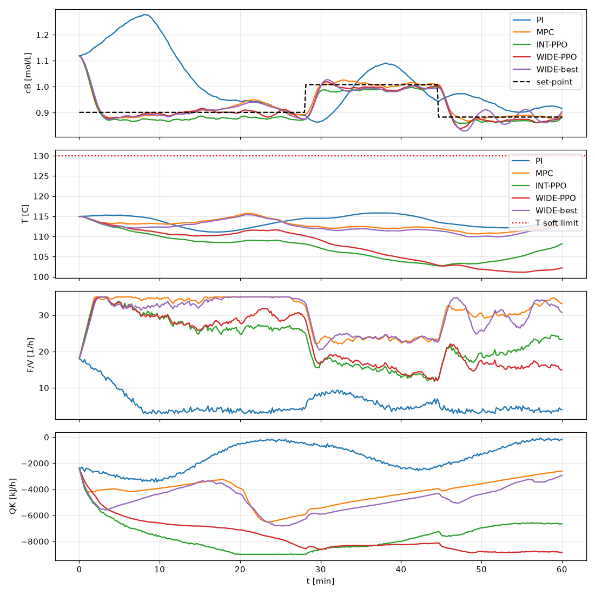

# RL Valve: reinforcement learning vs PI vs MPC on a Van de Vusse CSTR

A jacketed continuous stirred-tank reactor runs the Van de Vusse reactions (A → B → C, 2A → D; B is the product).
A controller sets the dilution rate **F/V** and the jacket duty **QK**. Its job is to track a **cB set-point**
while keeping **T below 130 °C**.

Three controllers run on identical scenarios:

- **PI:** the industrial baseline, two grid-tuned loops (cB ← F/V, T ← QK).
- **Nonlinear MPC:** CasADi + IPOPT with an offset-free disturbance observer.
- **PPO:** an RL policy, finally trained as **MPC-guided PPO**: behaviour cloning, then PPO with a decaying imitation term plus DAgger, using error-memory inputs and wide domain randomisation.



## Results
Results are averaged over 20 identical scenarios per set (`evaluate.py --mpc --mode all --episodes 20 --seed 20000`).
Error is the mean |cB − set-point| in mol/L. There were no runaways and no time above 130 °C in any run.

| | PI | NMPC | **WIDE-PPO** |
|---|---|---|---|
| Nominal plant | 0.078 | **0.011** | 0.013 |
| Perturbed (training-range disturbances) | 0.093 | **0.030** | 0.032 |
| **Hard, held out** (kinetics 15–22 % off) | 0.110 | **0.046** | **0.046** |
| Hard-set reward | −501 | −177 | **−175** |
| Valve moves F / Q, hard set | 107 / 58 | **65 / 19** | 83 / 24 |
| Compute per decision | ~0 | 10–34 ms | **0.6 ms** |

**Summary:** the final policy matches nonlinear MPC on plants it never saw in training, at about 1/20–1/50 of the compute and with no optimiser running online. PI is 3–8× worse because of the coupling between loops, the sign change in the cB gain near the optimum, and dead time.

### How the RL controller got there
| Model (`runs/…/final_model.zip`) | What it is | Takeaway |
|---|---|---|
| `kaggle_v2/run` | Pure PPO, 2M steps on a Kaggle T4 | Beats PI (nominal 0.014), but the valves chatter |
| `kaggle_v3/run` | v2 resumed to 5M steps, move penalty 0.5 | Learns bang-bang cooling; tracking gets worse |
| `imit` | MPC-guided PPO (11 inputs) | Smooth valves, nominal 0.0126 |
| `imit_int` | + 5/20-min error-memory inputs (13 inputs) | Ties MPC on nominal; weak on large kinetic mismatch |
| **`imit_wide`** | + wide kinetic randomisation (±15 %) | **Final model: ties MPC on the held-out hard set** |

## The plant model and environment
- **Model:** the Klatt & Engell (1998) parameters: Arrhenius kinetics, material, energy and jacket balances, a heat-transfer limit, and a cooling-only jacket. Nominal steady state: cA 2.14, cB 1.09 mol/L, T 114.2 °C.
- **Integration:** fixed-step RK4, checked against SciPy LSODA (`check_model.py`).
- **Sensors:** a 20 s dead time plus a 30 s thermocouple lag on T, a 10 s lag on TK, a 30 s analyzer delay on cA/cB, and noise.
- **Actuators:** saturation (F/V 3–35 h⁻¹, QK −9000–0 kJ/h) and rate limits (1.5 h⁻¹ and 400 kJ/h per 10 s step).
- **Disturbances and mismatch:** feed-temperature drift, fouling, loss of coolant capacity, feed-concentration error, and kinetic/enthalpy mismatch.
- **Scenario modes:** `nominal`, `randomized`, `randomized_wide` (training) and `perturbed`, `hard` (testing; `hard` is never used for training or model selection).
- **Reward:** the tracking error, a soft-T penalty, a move penalty, and −50 with termination if T > 150 °C.

## Repository layout
| Path | Contents |
|---|---|
| `cstr/vdv.py` | Model, parameters, RK4 + SciPy integrators, steady state, Jacobian |
| `cstr/env.py` | Gymnasium env with sensor and actuator dynamics and the scenario modes |
| `cstr/baseline.py` | Dual PI baseline |
| `cstr/mpc.py` | NMPC (multiple shooting, N = 20 / 200 s, observer with integrating disturbances) |
| `cstr/imitation.py` | MPC demonstrations, behaviour cloning, λ-decaying BC + DAgger callback |
| `check_model.py` | Model checks: literature steady state, mass balance, integrator, stability, selectivity map |
| `train.py` | Resumable PPO training (cumulative `--total-steps`, `--resume auto`) |
| `imitate.py` | MPC-guided PPO pipeline: `demos → bc → finetune` |
| `evaluate.py` | PI / MPC / PPO on identical scenarios: metrics, plots, JSON |
| `kaggle/` | `make_cell.py` packs the sources into one notebook cell; `cell_run.txt` holds the run commands |
| `runs/` | Trained models (`final_model.zip` + `summary.json` for each stage) |
| `results/` | Model-check figure and the final comparison |

## Quick start
```powershell
py -3.11 -m venv .venv
.\.venv\Scripts\pip install torch --index-url https://download.pytorch.org/whl/cpu
.\.venv\Scripts\pip install -r requirements.txt
.\.venv\Scripts\python check_model.py
.\.venv\Scripts\python evaluate.py --mpc --mode all --episodes 20 --seed 20000 --model runs\imit_int\final_model.zip runs\imit_wide\final_model.zip --labels INT-PPO WIDE-PPO --out results\compare_wide
```
On Linux or macOS, use `python3.11 -m venv .venv` and `.venv/bin/python`.

## Reproducing the training
**1. Pure PPO (GPU, e.g. on Kaggle).**
Run `python kaggle/make_cell.py`, paste `kaggle/cell_unpack.py` into cell 1, and use `kaggle/cell_run.txt` for the remaining cells.

To continue later without retraining, attach the previous notebook output as an input and raise `--total-steps`. `--resume auto` finds the newest checkpoint.
```bash
python train.py --total-steps 2000000 --save-dir runs/ppo --device cuda --n-envs 8
python train.py --total-steps 5000000 --save-dir runs/ppo --resume auto --move-penalty 0.5
```

**2. MPC-guided PPO (CPU: the MPC needs cores, not a GPU).**
With 16 GB of RAM, keep `workers + n-envs` at about 20 or fewer.
```powershell
# 11 inputs, starting from the v2 policy (~30 min)
python imitate.py --workers 8 --n-envs 12
# + error memory (13 inputs, new network)
python imitate.py --integral-obs --base fresh --out runs/imit_int --workers 4 --n-envs 8 --bc-epochs 80 --critic-warmup 300000
# + wide randomisation (final model, ~25 min)
python imitate.py --integral-obs --train-mode randomized_wide --base runs/imit_int/final_model.zip --out runs/imit_wide --workers 4 --n-envs 8
```
The fine-tune loss is `PPO + λ(t)·‖π_mean − a_MPC‖²`, with λ decaying geometrically from 1 to 0.05. Before it starts, a 150k-step warm-up trains the critic with the actor frozen. Every 250k steps a DAgger round runs the current policy with the MPC labelling in shadow mode.

## References
- Klatt, K.-U., Engell, S. (1998). *Gain-scheduling trajectory control of a continuous stirred tank reactor.* Computers & Chemical Engineering 22(4–5).
- Chen, H. et al. (1995). *Nonlinear predictive control of a benchmark CSTR.* Proc. ECC.
- Schulman, J. et al. (2017). *Proximal Policy Optimization Algorithms.* arXiv:1707.06347.
- Ross, S., Gordon, G., Bagnell, D. (2011). *A reduction of imitation learning and structured prediction to no-regret online learning (DAgger).* AISTATS.

## License
MIT (see `LICENSE`).
