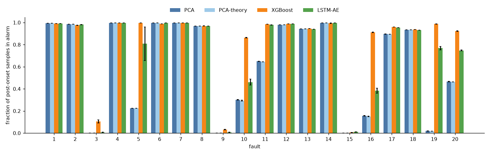
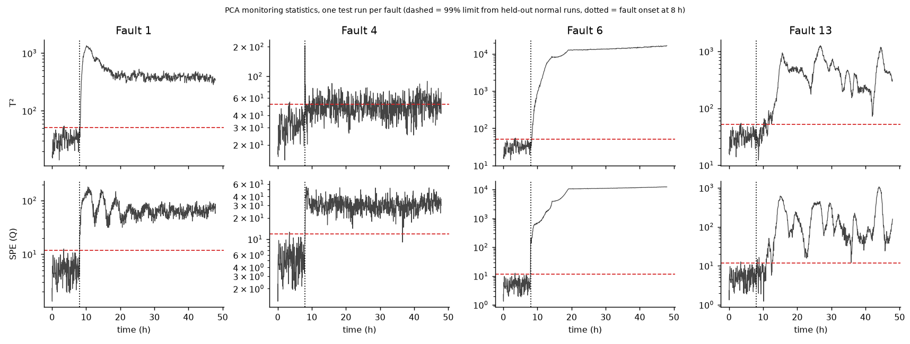
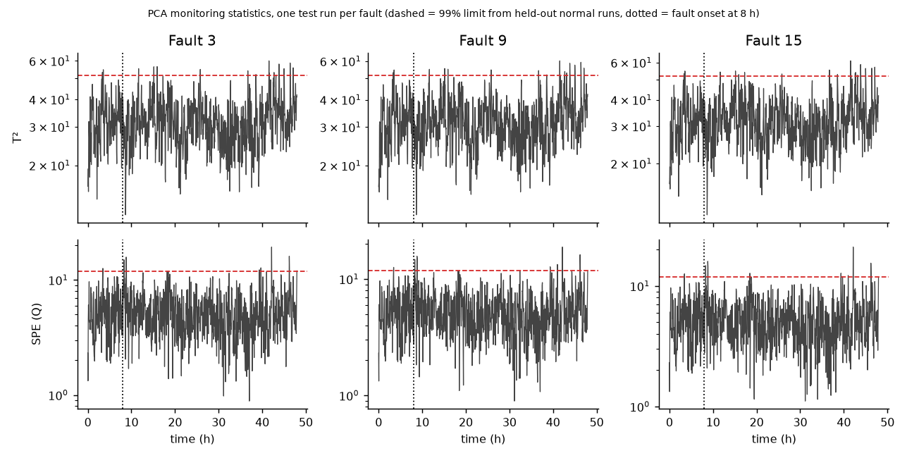
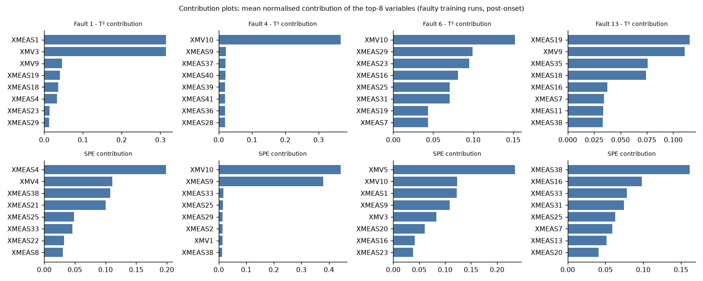
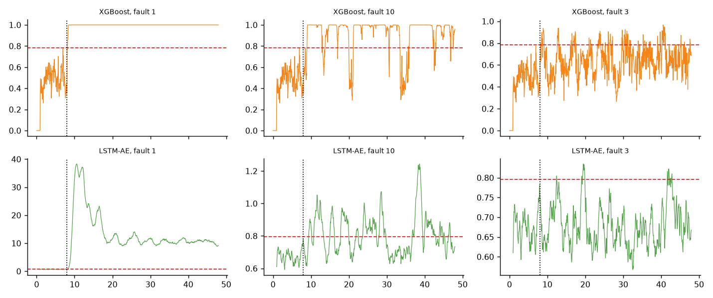
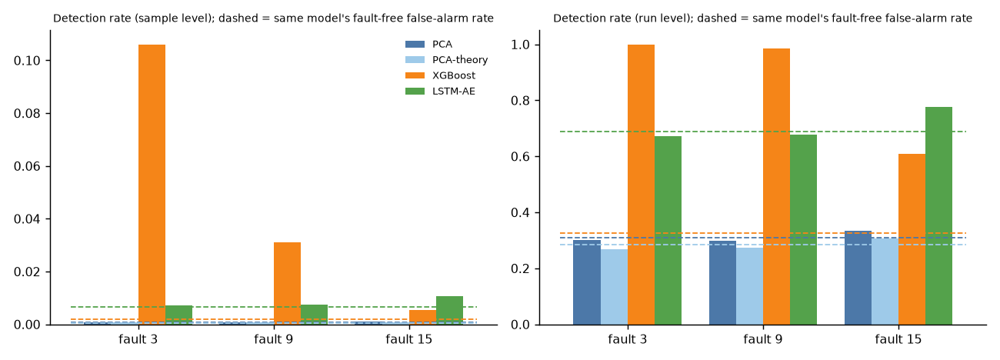

# Tennessee Eastman Process - fault detection and diagnosis

Everything below is read from `results/` (regenerate with `scripts/07_report.py`). All test numbers come from the official Rieth et al. (2017) **testing** files; nothing was tuned on them. Plus/minus values are 95% t-intervals over 5 seeds (each seed redraws the run split used for thresholds / early stopping and re-initialises the models).

## 1. What was achieved (and what was not)

**Achieved**

- A Downs & Vogel simulator was built and its normal operating point reproduced (worst error 0.24% over XMEAS 1-22).
- Four detectors evaluated on the official split with a fixed alarm rule: PCA (T²/SPE) with held-out-normal limits, PCA with textbook limits, XGBoost on windowed features, and an LSTM autoencoder (+ MLP diagnosis head, trained on Kaggle).
- **PCA**: mean over 20 faults - detection rate (post-onset samples in alarm) 62.6 ± 0.1%, runs detected 89.7 ± 0.2%, sample-level false-alarm rate 0.06 ± 0.00%, diagnosis accuracy 64.3 ± 0.1%.
- **XGBoost**: mean over 20 faults - detection rate (post-onset samples in alarm) 82.7 ± 0.1%, runs detected 98.0 ± 0.4%, sample-level false-alarm rate 0.20 ± 0.02%, diagnosis accuracy 86.5 ± 0.1%.
- **LSTM-AE**: mean over 20 faults - detection rate (post-onset samples in alarm) 74.6 ± 0.9%, runs detected 95.6 ± 0.6%, sample-level false-alarm rate 0.66 ± 0.11%, diagnosis accuracy 81.8 ± 0.5%.
- Fault 3: detection rate is meaningfully above the model's own false-alarm baseline (>= 2x and >= 1 percentage point) only for XGBoost; best detection rate of any model 10.6% (Section 5; the criterion is explained there).
- Fault 9: detection rate is meaningfully above the model's own false-alarm baseline (>= 2x and >= 1 percentage point) only for XGBoost; best detection rate of any model 3.1% (Section 5; the criterion is explained there).
- Fault 15: no model is meaningfully above its false-alarm baseline (>= 2x and >= 1 percentage point); best detection rate of any model 1.1% (Section 5; the criterion is explained there).

**Not achieved / hoped for**

- The 99% detection target was **not** reached by any method on 14 of 20 faults: 2 (best 98.4%), 3 (best 10.6%), 8 (best 96.9%), 9 (best 3.1%), 10 (best 86.3%), 11 (best 98.5%), 12 (best 98.7%), 13 (best 94.6%), 15 (best 1.1%), 16 (best 91.1%), 17 (best 95.9%), 18 (best 93.6%), 19 (best 98.7%), 20 (best 92.2%). I report these numbers as measured and did not change the evaluation to improve them.
- Diagnosis accuracy above 99% appears only for some faults and only for the supervised classifiers/signature library; see Section 6 for the leakage checks that were run.
- Faults 3, 9 and 15 remain far from the 99% target for every model (see above); fault 3 is partly detectable by the supervised models, faults 9 and 15 barely.

## 2. Setup and provenance

**Simulator.** Original Downs & Vogel (1993) Fortran (`teprob.f`) with the `temain_mod.f` driver as modified by Xavier & de Seixas (2018) and wrapped by `camaramm/tep2py` (GitHub master, downloaded 2026-11-21 into `vendor/`). Compiled with gfortran 16.2.0 (WinLibs, UCRT) into a Python 3.11 extension (`sim/build_ext.ps1`; `numpy.f2py -c` failed on this setup so the f2py-generated wrappers are compiled by hand). The PyPI package named `tep` is an unrelated testing tool and was not used.

**Operating-point check** (`sim/verify_operating_point.py`, zero disturbances, 500 samples = 25 h): mean of each of XMEAS 1-22 vs the published base case: median error 0.05%, worst 0.24%.

| XMEAS | published | simulated mean (25 h) | error % |
|---|---|---|---|
| 1 | 0.2505 | 0.2503 | 0.07 |
| 7 | 2705 | 2706 | 0.05 |
| 8 | 75 | 74.98 | 0.02 |
| 9 | 120.4 | 120.4 | 0.00 |
| 13 | 2634 | 2635 | 0.05 |
| 20 | 341.4 | 341.7 | 0.08 |
| 21 | 94.6 | 94.6 | 0.00 |

(All 22 rows are in `results/sim_verification.json`.) Note the Rieth data were generated by the original authors' own simulator and control setup, so the simulator here is used for verification only; **no model was trained on simulator output** - all models use the official Rieth files.

**Dataset.** Rieth, Amsel, Tran & Cook (2017), Harvard Dataverse doi:10.7910/DVN/6C3JR1, version 1.0 (released 2017-07-06). Four `.RData` files, MD5s verified against Dataverse:
| file | MD5 |
|---|---|
| TEP_FaultFree_Training.RData | ec126484534331f85001d8c4ebce6d17 |
| TEP_FaultFree_Testing.RData | 38ad9810fc871026157086ae2c2f0ee9 |
| TEP_Faulty_Training.RData | c5f594d54c47e620ff877feb58407fda |
| TEP_Faulty_Testing.RData | 556bdb64c83021bc0c5f92e427753565 |

Official split kept as is: training = 500 fault-free runs + 500 runs per fault (500 samples, fault from sample 20); testing = 500 fault-free runs + 500 runs per fault (960 samples, fault from sample 160). Sampling interval 3 min. Faults 1-20 (the dataset has no fault 21).

**Preprocessing (complete list).** sort by (faultNumber, simulationRun, sample); keep xmeas_1..41 + xmv_1..11 (52 columns); float64 -> float32; NO resplitting: official training/testing files kept separate; NO scaling here (scalers are fit on fault-free TRAIN only, inside each model script). Per model: PCA - standardise with training-normal mean/std, keep PCs for 90% cumulative variance (31 PCs); XGBoost - causal 20-sample windows, features mean/std/last/last-minus-first per variable (208 features), trees are scale-free; LSTM-AE - standardise with training-normal mean/std, 20-sample windows.

**Software.** Python 3.11.9, numpy 2.4.6, pandas 3.1.1, scikit-learn 1.9.1, scipy 1.17.1, xgboost 3.2.0. LSTM-AE trained on Kaggle (torch 2.11.0+cu130, GPU Tesla T4). Master seed 20240607; seeds 0-4.

## 3. Methods and evaluation protocol

- **Validation split:** in every seed, 80% of the training runs (by run) fit the model; the other 20% are used **only** for early stopping and for the alarm threshold. Faulty test runs never influence any threshold.
- **Alarm rule (identical for all models, fixed before looking at test results):** score above its limit for K=3 consecutive samples; limit = 99th percentile of the score on held-out fault-free training runs (PCA-theory instead uses the F-distribution T² limit and Jackson-Mudholkar SPE limit at 99%).
- **PCA:** alarm if T² or SPE exceeds its limit. **Diagnosis:** contribution vectors (T² contributions, SPE contributions) are matched by cosine similarity to per-fault mean-contribution signatures built from faulty *training* runs - this is a signature lookup, not a trained learner.
- **XGBoost:** multi-class (normal + 20 faults) on windowed features; detection score = 1 - P(normal); diagnosis = arg-max class.
- **LSTM-AE:** LSTM encoder-decoder (hidden 64, latent 16) trained on normal windows only; detection score = window reconstruction error; diagnosis by an MLP on the latent code + per-variable reconstruction error trained on faulty training windows.
- **Metrics (per fault, 500 test runs):** *detection rate* = fraction of post-onset samples in alarm (the usual TEP FDR); *runs detected* = fraction of runs with at least one post-onset alarm; *delay* = mean (first alarm - onset) over detected runs, in minutes; *false-alarm rate* = alarm rate on the 500 fault-free test runs (sample-level and run-level); *diagnosis accuracy* = fraction of samples fully after onset whose predicted class equals the true fault.

## 4. Results - all 20 faults

### 4.1 Detection (mean ± 95% CI over 5 seeds; % of post-onset samples in alarm / % of runs detected)

| Fault | PCA samples | XGBoost samples | LSTM-AE samples | PCA runs | XGBoost runs | LSTM-AE runs |
|---|---|---|---|---|---|---|
| 1 | 99.5 ± 0.0 | 99.1 ± 0.1 | 99.1 ± 0.0 | 100.0 ± 0.0 | 100.0 ± 0.0 | 100.0 ± 0.0 |
| 2 | 98.4 ± 0.0 | 97.6 ± 0.1 | 98.1 ± 0.0 | 100.0 ± 0.0 | 100.0 ± 0.0 | 100.0 ± 0.0 |
| 3 | 0.1 ± 0.0 | 10.6 ± 1.5 | 0.7 ± 0.1 | 30.0 ± 1.2 | 100.0 ± 0.0 | 67.1 ± 3.9 |
| 4 | 99.7 ± 0.0 | 99.7 ± 0.0 | 99.7 ± 0.0 | 100.0 ± 0.0 | 100.0 ± 0.0 | 100.0 ± 0.0 |
| 5 | 22.5 ± 0.1 | 99.6 ± 0.0 | 80.8 ± 15.2 | 100.0 ± 0.0 | 100.0 ± 0.0 | 100.0 ± 0.0 |
| 6 | 99.8 ± 0.0 | 98.8 ± 0.1 | 99.7 ± 0.0 | 100.0 ± 0.0 | 100.0 ± 0.0 | 100.0 ± 0.0 |
| 7 | 99.8 ± 0.0 | 99.7 ± 0.0 | 99.8 ± 0.0 | 100.0 ± 0.0 | 100.0 ± 0.0 | 100.0 ± 0.0 |
| 8 | 96.9 ± 0.0 | 96.9 ± 0.0 | 96.8 ± 0.0 | 100.0 ± 0.0 | 100.0 ± 0.0 | 100.0 ± 0.0 |
| 9 | 0.1 ± 0.0 | 3.1 ± 0.3 | 0.7 ± 0.1 | 29.9 ± 1.5 | 98.5 ± 0.5 | 67.8 ± 4.3 |
| 10 | 30.1 ± 0.3 | 86.3 ± 0.3 | 46.1 ± 2.7 | 100.0 ± 0.0 | 100.0 ± 0.0 | 100.0 ± 0.0 |
| 11 | 65.0 ± 0.2 | 98.5 ± 0.1 | 97.8 ± 0.1 | 100.0 ± 0.0 | 100.0 ± 0.0 | 100.0 ± 0.0 |
| 12 | 98.0 ± 0.0 | 98.7 ± 0.0 | 98.7 ± 0.0 | 100.0 ± 0.0 | 100.0 ± 0.0 | 100.0 ± 0.0 |
| 13 | 94.3 ± 0.0 | 94.6 ± 0.0 | 94.0 ± 0.0 | 100.0 ± 0.0 | 100.0 ± 0.0 | 100.0 ± 0.0 |
| 14 | 99.7 ± 0.0 | 99.4 ± 0.2 | 99.6 ± 0.0 | 100.0 ± 0.0 | 100.0 ± 0.0 | 100.0 ± 0.0 |
| 15 | 0.1 ± 0.0 | 0.5 ± 0.1 | 1.1 ± 0.1 | 33.4 ± 1.8 | 60.8 ± 8.4 | 77.6 ± 4.3 |
| 16 | 15.7 ± 0.3 | 91.1 ± 0.4 | 38.3 ± 2.2 | 100.0 ± 0.0 | 100.0 ± 0.0 | 100.0 ± 0.0 |
| 17 | 89.6 ± 0.1 | 95.9 ± 0.0 | 95.3 ± 0.0 | 100.0 ± 0.0 | 100.0 ± 0.0 | 100.0 ± 0.0 |
| 18 | 93.4 ± 0.0 | 93.6 ± 0.0 | 93.0 ± 0.0 | 100.0 ± 0.0 | 100.0 ± 0.0 | 100.0 ± 0.0 |
| 19 | 2.0 ± 0.1 | 98.7 ± 0.1 | 76.9 ± 1.6 | 100.0 ± 0.1 | 100.0 ± 0.0 | 100.0 ± 0.0 |
| 20 | 46.6 ± 0.2 | 92.2 ± 0.3 | 74.8 ± 0.4 | 100.0 ± 0.0 | 100.0 ± 0.0 | 100.0 ± 0.0 |
| ALL (mean) | 62.6 ± 0.1 | 82.7 ± 0.1 | 74.6 ± 0.9 | 89.7 ± 0.2 | 98.0 ± 0.4 | 95.6 ± 0.6 |

### 4.2 Mean detection delay in minutes (over detected runs; mean over faults in last row)

| Fault | PCA | XGBoost | LSTM-AE |
|---|---|---|---|
| 1 | 12 ± 0 | 21 ± 1 | 21 ± 0 |
| 2 | 37 ± 0 | 58 ± 2 | 45 ± 0 |
| 3 | 1180 ± 15 | 159 ± 10 | 949 ± 23 |
| 4 | 7 ± 0 | 6 ± 0 | 7 ± 0 |
| 5 | 6 ± 0 | 9 ± 0 | 10 ± 0 |
| 6 | 6 ± 0 | 28 ± 2 | 7 ± 0 |
| 7 | 6 ± 0 | 8 ± 0 | 6 ± 0 |
| 8 | 63 ± 0 | 70 ± 1 | 72 ± 1 |
| 9 | 1162 ± 22 | 529 ± 48 | 951 ± 24 |
| 10 | 187 ± 2 | 96 ± 1 | 157 ± 8 |
| 11 | 30 ± 0 | 29 ± 0 | 33 ± 0 |
| 12 | 29 ± 0 | 30 ± 1 | 31 ± 0 |
| 13 | 128 ± 0 | 125 ± 1 | 135 ± 2 |
| 14 | 7 ± 0 | 11 ± 1 | 11 ± 0 |
| 15 | 1184 ± 35 | 995 ± 71 | 875 ± 39 |
| 16 | 133 ± 2 | 47 ± 1 | 126 ± 6 |
| 17 | 103 ± 0 | 96 ± 1 | 109 ± 1 |
| 18 | 156 ± 0 | 151 ± 1 | 159 ± 1 |
| 19 | 264 ± 8 | 27 ± 1 | 53 ± 2 |
| 20 | 136 ± 0 | 122 ± 1 | 143 ± 1 |
| ALL (mean) | 242 ± 3 | 131 ± 6 | 195 ± 4 |

### 4.3 Diagnosis accuracy (%, samples fully after onset)

| Fault | PCA | XGBoost | LSTM-AE | PCA (alarmed only) | XGBoost (alarmed only) | LSTM-AE (alarmed only) |
|---|---|---|---|---|---|---|
| 1 | 95.6 ± 0.0 | 100.0 ± 0.0 | 100.0 ± 0.0 | 96.1 ± 0.0 | 100.0 ± 0.0 | 100.0 ± 0.0 |
| 2 | 97.3 ± 0.1 | 100.0 ± 0.0 | 100.0 ± 0.0 | 98.8 ± 0.1 | 100.0 ± 0.0 | 100.0 ± 0.0 |
| 3 | 8.5 ± 0.5 | 54.1 ± 1.2 | 0.1 ± 0.1 | 11.0 ± 1.3 | 96.5 ± 0.5 | 0.0 ± 0.1 |
| 4 | 99.2 ± 0.0 | 100.0 ± 0.0 | 99.9 ± 0.0 | 99.4 ± 0.0 | 100.0 ± 0.0 | 99.9 ± 0.0 |
| 5 | 79.7 ± 0.1 | 100.0 ± 0.0 | 99.9 ± 0.0 | 36.1 ± 0.4 | 100.0 ± 0.0 | 99.9 ± 0.1 |
| 6 | 67.1 ± 0.2 | 100.0 ± 0.0 | 100.0 ± 0.0 | 67.0 ± 0.2 | 100.0 ± 0.0 | 100.0 ± 0.0 |
| 7 | 95.8 ± 0.0 | 100.0 ± 0.0 | 100.0 ± 0.0 | 95.9 ± 0.0 | 100.0 ± 0.0 | 100.0 ± 0.0 |
| 8 | 59.2 ± 0.1 | 98.8 ± 0.0 | 98.0 ± 0.3 | 60.5 ± 0.1 | 99.4 ± 0.0 | 98.6 ± 0.3 |
| 9 | 12.1 ± 0.5 | 0.7 ± 0.0 | 0.0 ± 0.0 | 13.6 ± 2.3 | 0.6 ± 0.2 | 0.0 ± 0.0 |
| 10 | 62.1 ± 0.1 | 92.2 ± 0.1 | 82.2 ± 6.2 | 80.4 ± 0.3 | 99.6 ± 0.1 | 91.0 ± 4.9 |
| 11 | 43.5 ± 0.0 | 99.7 ± 0.0 | 99.1 ± 0.1 | 41.5 ± 0.1 | 99.9 ± 0.0 | 99.5 ± 0.1 |
| 12 | 66.4 ± 0.3 | 97.0 ± 0.3 | 93.5 ± 2.0 | 67.1 ± 0.3 | 97.1 ± 0.3 | 93.5 ± 2.0 |
| 13 | 80.3 ± 0.1 | 94.9 ± 0.3 | 93.8 ± 1.2 | 84.9 ± 0.1 | 97.7 ± 0.3 | 96.9 ± 1.2 |
| 14 | 76.7 ± 0.1 | 100.0 ± 0.0 | 100.0 ± 0.0 | 76.7 ± 0.1 | 100.0 ± 0.0 | 100.0 ± 0.0 |
| 15 | 26.1 ± 1.0 | 7.8 ± 1.0 | 4.6 ± 3.0 | 30.0 ± 1.2 | 43.6 ± 16.5 | 16.0 ± 5.9 |
| 16 | 61.9 ± 0.1 | 94.8 ± 0.3 | 82.9 ± 4.1 | 89.4 ± 0.2 | 98.6 ± 0.1 | 88.6 ± 3.4 |
| 17 | 74.2 ± 0.0 | 97.9 ± 0.1 | 97.7 ± 0.1 | 79.7 ± 0.0 | 99.8 ± 0.0 | 100.0 ± 0.0 |
| 18 | 69.2 ± 0.1 | 95.4 ± 0.3 | 92.7 ± 1.3 | 73.3 ± 0.1 | 99.2 ± 0.3 | 96.9 ± 1.4 |
| 19 | 50.4 ± 0.1 | 99.9 ± 0.0 | 99.7 ± 0.1 | 51.4 ± 0.1 | 100.0 ± 0.0 | 99.9 ± 0.0 |
| 20 | 61.4 ± 0.0 | 96.0 ± 0.2 | 92.6 ± 1.3 | 92.8 ± 0.1 | 99.7 ± 0.1 | 99.6 ± 0.1 |
| ALL (mean) | 64.3 ± 0.1 | 86.5 ± 0.1 | 81.8 ± 0.5 | 67.3 ± 0.1 | 91.6 ± 0.8 | 84.0 ± 0.6 |

### 4.4 False alarms on the 500 fault-free test runs

| Model | samples in alarm % | runs with >=1 alarm % | pre-onset alarm rate in faulty runs % (mean over faults) |
|---|---|---|---|
| PCA | 0.06 ± 0.00 | 30.9 ± 1.1 | 0.03 ± 0.00 |
| PCA-theory | 0.06 ± 0.00 | 28.5 ± 0.8 | 0.02 ± 0.00 |
| XGBoost | 0.20 ± 0.02 | 32.5 ± 5.8 | 0.12 ± 0.03 |
| LSTM-AE | 0.66 ± 0.11 | 68.9 ± 4.8 | 0.60 ± 0.09 |

The run-level false-alarm rate is high for every model because a fault-free test run has 960 samples and a single alarm counts; it is the right baseline for the run-level detection numbers.

### 4.5 Overall (mean over the 20 faults)

| Model | detection rate % | runs detected % | delay min | false-alarm (sample) % | diagnosis acc. % |
|---|---|---|---|---|---|
| PCA | 62.6 ± 0.1 | 89.7 ± 0.2 | 242 ± 3 | 0.06 ± 0.00 | 64.3 ± 0.1 |
| PCA-theory | 62.4 ± 0.0 | 89.2 ± 0.1 | 246 ± 3 | 0.06 ± 0.00 | 64.3 ± 0.1 |
| XGBoost | 82.7 ± 0.1 | 98.0 ± 0.4 | 131 ± 6 | 0.20 ± 0.02 | 86.5 ± 0.1 |
| LSTM-AE | 74.6 ± 0.9 | 95.6 ± 0.6 | 195 ± 4 | 0.66 ± 0.11 | 81.8 ± 0.5 |

PCA-theory (textbook limits) is a variant of the PCA baseline; it is shown here and in `results/models/PCA-theory/` but kept out of the per-fault tables to save space.



### 4.6 T² and SPE plots (PCA, seed 0, one test run per fault)





### 4.7 Contribution plots and model scores





## 5. Faults 3, 9 and 15

| Fault | Model | detection (samples) % | false-alarm (samples) % | ratio | runs detected % | fault-free runs with alarm % | pre-onset alarm % (same runs) | statistically above baseline? | meaningfully above (>=2x and >=1 pp)? | diagnosis acc. % |
|---|---|---|---|---|---|---|---|---|---|---|
| 3 | PCA | 0.07 ± 0.01 | 0.06 ± 0.00 | 1.1x | 30.0 ± 1.2 | 30.9 ± 1.1 | 0.03 ± 0.00 | no | no | 8.5 ± 0.5 |
| 3 | PCA-theory | 0.06 ± 0.00 | 0.06 ± 0.00 | 1.1x | 26.8 ± 0.8 | 28.5 ± 0.8 | 0.02 ± 0.00 | yes | no | 8.5 ± 0.5 |
| 3 | XGBoost | 10.61 ± 1.46 | 0.20 ± 0.02 | 53.5x | 100.0 ± 0.0 | 32.5 ± 5.8 | 0.12 ± 0.03 | yes | yes | 54.1 ± 1.2 |
| 3 | LSTM-AE | 0.71 ± 0.11 | 0.66 ± 0.11 | 1.1x | 67.1 ± 3.9 | 68.9 ± 4.8 | 0.60 ± 0.09 | no | no | 0.1 ± 0.1 |
| 9 | PCA | 0.07 ± 0.01 | 0.06 ± 0.00 | 1.1x | 29.9 ± 1.5 | 30.9 ± 1.1 | 0.03 ± 0.00 | yes | no | 12.1 ± 0.5 |
| 9 | PCA-theory | 0.07 ± 0.00 | 0.06 ± 0.00 | 1.2x | 27.3 ± 0.6 | 28.5 ± 0.8 | 0.02 ± 0.00 | yes | no | 12.1 ± 0.5 |
| 9 | XGBoost | 3.11 ± 0.34 | 0.20 ± 0.02 | 15.7x | 98.5 ± 0.5 | 32.5 ± 5.8 | 0.12 ± 0.03 | yes | yes | 0.7 ± 0.0 |
| 9 | LSTM-AE | 0.73 ± 0.11 | 0.66 ± 0.11 | 1.1x | 67.8 ± 4.3 | 68.9 ± 4.8 | 0.60 ± 0.09 | no | no | 0.0 ± 0.0 |
| 15 | PCA | 0.09 ± 0.01 | 0.06 ± 0.00 | 1.4x | 33.4 ± 1.8 | 30.9 ± 1.1 | 0.03 ± 0.00 | yes | no | 26.1 ± 1.0 |
| 15 | PCA-theory | 0.08 ± 0.00 | 0.06 ± 0.00 | 1.4x | 30.6 ± 0.7 | 28.5 ± 0.8 | 0.02 ± 0.00 | yes | no | 26.1 ± 1.0 |
| 15 | XGBoost | 0.53 ± 0.12 | 0.20 ± 0.02 | 2.7x | 60.8 ± 8.4 | 32.5 ± 5.8 | 0.12 ± 0.03 | yes | no | 7.8 ± 1.0 |
| 15 | LSTM-AE | 1.07 ± 0.15 | 0.66 ± 0.11 | 1.6x | 77.6 ± 4.3 | 68.9 ± 4.8 | 0.60 ± 0.09 | yes | no | 4.6 ± 3.0 |

*Statistically above* = lower end of the detection-rate interval is above the upper end of the model's own fault-free false-alarm interval. Because the intervals are extremely narrow, this flags differences as small as 0.01 percentage points, so I **added after seeing the results** a second, practical criterion (at least 2x the false-alarm rate and at least 1 percentage point higher); it is an interpretation threshold only and no model or threshold depends on it. A detector alarming at random with the same false-alarm rate would show a detection rate equal to its false-alarm rate, and a run-level detection rate equal to its fault-free run-level false-alarm rate.



**Does any method beat the false-alarm baseline?** Meaningfully (>= 2x and >= 1 percentage point): fault 3 / XGBoost, fault 9 / XGBoost. Statistically but only trivially (differences of a fraction of a percentage point): fault 3 / PCA-theory, fault 9 / PCA, fault 9 / PCA-theory, fault 15 / PCA, fault 15 / PCA-theory, fault 15 / XGBoost, fault 15 / LSTM-AE. Not at all: fault 3 / PCA, fault 3 / LSTM-AE, fault 9 / LSTM-AE. The clearest case is XGBoost on fault 3 (10.6 ± 1.5% of post-onset samples vs 0.20 ± 0.02% false alarms, diagnosis 54.1 ± 1.2%), followed by fault 9 (3.1 ± 0.3% vs the same false-alarm rate). Even where the baseline is beaten the absolute detection rates are small, so none of the three faults is reliably detectable here. Run-level numbers are not informative for these faults: every model's run-level detection is roughly the fault-free run-level false-alarm rate or higher simply because 800 post-onset samples give a run many chances to alarm (XGBoost: 100.0 ± 0.0% / 98.5 ± 0.5% / 60.8 ± 8.4% of runs for faults 3 / 9 / 15 against 32.5 ± 5.8% of fault-free runs). The LSTM-AE (autoencoder trained on normal data only) and PCA do not separate any of the three from normal operation at a useful level.

**Is XGBoost's fault-3 detection real signal or an artifact?** Post-hoc diagnostic (`scripts/08_hard_fault_check.py`, run *after* seeing the main results, used only to explain them and not to change any model or threshold): a binary XGBoost (normal vs fault f) trained on training files only, evaluated on test windows. `AUC within run` compares windows before and after onset **inside the same faulty test runs**, which removes any difference between fault-free and faulty runs (different random seeds, initial conditions). Window level, no consecutive-alarm rule, threshold at the 99th percentile of held-out fault-free training windows.

| Fault | AUC fault-free vs post-onset | AUC pre vs post onset (same runs) | post-onset windows above threshold % | fault-free windows above % | pre-onset windows above % | top features (gain) |
|---|---|---|---|---|---|---|
| 3 | 0.952 | 0.961 | 52.5 | 1.1 | 0.8 | mean:xmeas_21, mean:xmeas_20, last:xmeas_20 |
| 9 | 0.564 | 0.627 | 2.7 | 1.1 | 0.6 | mean:xmeas_20, mean:xmeas_4, last:xmeas_20 |
| 15 | 0.635 | 0.670 | 4.1 | 1.0 | 0.8 | std:xmeas_22, std:xmeas_11, std:xmeas_18 |
| 5 | 1.000 | 1.000 | 100.0 | 1.2 | 0.8 | mean:xmv_11, last:xmv_11, std:xmv_5 |
| 19 | 1.000 | 1.000 | 100.0 | 1.0 | 0.6 | std:xmeas_5, std:xmv_5, std:xmv_10 |
| 1 | 1.000 | 1.000 | 100.0 | 1.0 | 0.5 | mean:xmeas_1, mean:xmv_4, last:xmv_3 |

Fault 3 is a genuine, weak, learnable signal: within the *same* runs the windows after onset are separable from those before it (AUC 0.96), the pre-onset windows alarm at the false-alarm level, and the leading features are XMEAS 21/20 (reactor cooling-water outlet temperature / compressor work) - plausible places for a feed-temperature step to show up through the heat balance (a physical interpretation I did not verify). Faults 9 and 15 show only a weak effect (AUC about 0.63 and 0.67 within the same runs). Faults 5 and 19, which PCA misses, are separated perfectly (AUC about 1.0 within run), so XGBoost's high detection of them is also not a run-level artifact. Caveat: this proves the change is tied to the fault onset in the simulator's data; it does not prove that a plant would show it, and the detection rate of this binary detector (window level, no consecutive-alarm rule) is not comparable to the main-protocol numbers above.

**Why these faults are hard in the closed-loop TEP.** Fault 3 is a step in the D feed temperature, fault 9 a random variation of the same temperature, and fault 15 a condenser-cooling-water valve sticking. With the plant under closed-loop control the regulators absorb these disturbances, so the measured variables hardly move. Measured on the test data (`results/fault_signal_strength.csv`; largest change, over the 52 variables, of the post-onset mean in units of the pre-onset standard deviation, and of the log standard-deviation ratio):

| Fault | max mean shift (pre-onset sd) | max |log std ratio| | variable |
|---|---|---|---|
| 0 (fault-free reference) | 0.10 | 0.36 | xmv_9 |
| 3 | 0.27 | 0.36 | xmeas_21 |
| 9 | 0.10 | 0.36 | xmv_9 |
| 15 | 0.10 | 0.37 | xmv_9 |
| 1 | 18.17 | 1.72 | xmv_3 |
| 4 | 7.04 | 0.36 | xmv_10 |
| 5 | 1.89 | 1.27 | xmv_11 |
| 10 | 0.29 | 1.37 | xmv_9 |
| 13 | 6.19 | 3.04 | xmv_9 |

Faults 9 and 15 are indistinguishable from the fault-free reference on this single-variable statistic (shift about 0.10 sd, equal to the 0.10 sd that fault-free runs show between two parts of the same run); fault 3 shows a small shift (0.27 sd) in one variable (XMEAS 21). The literature describes these faults as having no observable change in mean, variance or higher-order statistics (e.g. Chiang & Zhang, as summarised in review articles). That matches why the unsupervised, label-free monitors (PCA T²/SPE, the autoencoder) cannot find them at a 99% control limit: the effect is a fraction of a standard deviation in a few variables, far below the normal run-to-run and sample-to-sample variation, and the controllers cancel most of the disturbance. A supervised model that has seen labelled examples can combine many tiny, consistent shifts (fault 3) and recovers some detection, but for faults 9 and 15 even that yields only a few percent.

## 6. Leakage checks (step 10)

Every (model, fault, metric) whose mean is above 99% was flagged automatically: LSTM-AE: 42 entries over faults 1, 2, 4, 5, 6, 7, 8, 10, 11, 12, 13, 14, 16, 17, 18, 19, 20; PCA: 24 entries over faults 1, 2, 4, 5, 6, 7, 8, 10, 11, 12, 13, 14, 16, 17, 18, 19, 20; PCA-theory: 24 entries over faults 1, 2, 4, 5, 6, 7, 8, 10, 11, 12, 13, 14, 16, 17, 18, 19, 20; XGBoost: 46 entries over faults 1, 2, 3, 4, 5, 6, 7, 8, 10, 11, 12, 13, 14, 16, 17, 18, 19, 20.

**A. Train/test separation.** Hash of every 52-value row: 5,250,000 train rows vs 10,080,000 test rows -> **0 identical rows** in both. Runs are therefore disjoint, so no window (cut inside one run) can overlap between train and test.

**B. Alarm timing.** If features leaked the fault label, alarms would also fire *before* onset. For all flagged entries the pre-onset alarm rate in the same faulty runs is at most 0.60% (fault-free false-alarm rate of those models: up to 0.66%), i.e. at the false-alarm level, while post-onset detection is >99%. Full list: `results/leakage_flagged.csv`.

**C/D. Label-shuffle control and pre-onset behaviour of the classifiers.** Same pipeline, training labels randomly permuted -> diagnosis accuracy must drop to chance. Pre-onset windows of faulty test runs must be classified 'normal'.
| Model | shuffled-label diagnosis acc. % | chance % | pre-onset windows predicted normal % |
|---|---|---|---|
| XGBoost | 0.00 | 4.8 | 96.1 |
| LSTM-AE | 0.25 | 5.0 | 98.1 |

**E. Construction audit.** label like columns used: []; scaler fit: fault-free TRAINING arrays only (PCA: 80% runs split by run; LSTM-AE: all 500 training runs, test untouched); thresholds: 99th percentile on held-out fault-free TRAINING runs (split by run); train windows: drawn only from the official train files; faulty-run windows start at/after onset so none straddle it; eval windows for diagnosis: start >= onset (160) in test runs, so none straddle onset; window overlap train vs test: impossible: windows are cut inside a single run and train/test runs are disjoint (Check A). Only the 52 process columns are model inputs (`faultNumber`, `simulationRun`, `sample` are dropped).

**Interpretation.** No leakage indicator fired: no row or run is shared between train and test, alarms do not appear before onset, shuffled labels give chance-level (or worse) accuracy, and pre-onset windows are classified normal. For faults 5 and 19, where the supervised models reach >98% but PCA does not, the within-run before/after-onset test in Section 5 (AUC about 1.0 inside the same runs) shows the signal is tied to the fault onset, not to a difference between runs. High values for faults 1, 2, 4, 6, 7, 12 and 14 are also seen by every method including PCA. One caveat remains, which is **not leakage but an optimistic setting**: training and test runs come from the same simulator with the same fault magnitudes, so supervised diagnosis will look better than on a plant with model mismatch. No check can rule out simulator-specific regularities that a real plant would not have.

## 7. Context: published TEP results

Per-fault detection rates (%) copied by hand from Agarwal et al., arXiv:2012.03861, Tables 4-5 (values for PCA, SAE-NN, DSN, GAN, OCSVM, CNN are quoted by that paper from earlier work; HDRNN = the paper's own LSTM-autoencoder hierarchy). **These are second-hand numbers on a data set/protocol that is not identical to the Rieth official split, and they do not state a false-alarm-matched operating point, so differences are indicative only.**

| Fault | ours PCA | ours XGB | ours LSTM-AE | pub. PCA T² | pub. PCA SPE | pub. GAN | pub. CNN | pub. HDRNN (LSTM-SAE) |
|---|---|---|---|---|---|---|---|---|
| 1 | 99.5 | 99.1 | 99.1 | 99.2 | 99.8 | 99.6 | 91.4 | 100.0 |
| 2 | 98.4 | 97.6 | 98.1 | 98.0 | 98.6 | 98.5 | 88.0 | 100.0 |
| 3 | 0.1 | 10.6 | 0.7 | n/r | n/r | 10.4 | 50.6 | 81.6 |
| 4 | 99.7 | 99.7 | 99.7 | 4.4 | 96.2 | 56.2 | 99.7 | 100.0 |
| 5 | 22.5 | 99.6 | 80.8 | 22.5 | 25.4 | 32.4 | 90.3 | 100.0 |
| 6 | 99.8 | 98.8 | 99.7 | 98.9 | 100.0 | 100.0 | 91.5 | 100.0 |
| 7 | 99.8 | 99.7 | 99.8 | 91.5 | 100.0 | 100.0 | 91.5 | 100.0 |
| 8 | 96.9 | 96.9 | 96.8 | 96.6 | 97.6 | 97.9 | 83.0 | 100.0 |
| 9 | 0.1 | 3.1 | 0.7 | n/r | n/r | 8.6 | 49.5 | 99.4 |
| 10 | 30.1 | 86.3 | 46.1 | 33.4 | 34.1 | 50.9 | 70.0 | 42.8 |
| 11 | 65.0 | 98.5 | 97.8 | 20.6 | 64.4 | 58.0 | 60.2 | 100.0 |
| 12 | 98.0 | 98.7 | 98.7 | 97.1 | 97.5 | 98.8 | 85.6 | 100.0 |
| 13 | 94.3 | 94.6 | 94.0 | 94.0 | 95.5 | 95.0 | 46.9 | 100.0 |
| 14 | 99.7 | 99.4 | 99.6 | 84.2 | 100.0 | 100.0 | 88.9 | 100.0 |
| 15 | 0.1 | 0.5 | 1.1 | n/r | n/r | 12.5 | 43.5 | 100.0 |
| 16 | 15.7 | 91.1 | 38.3 | 16.6 | 24.5 | 34.4 | 66.8 | 100.0 |
| 17 | 89.6 | 95.9 | 95.3 | 74.1 | 89.2 | 91.1 | 77.1 | 100.0 |
| 18 | 93.4 | 93.6 | 93.0 | 88.7 | 89.9 | 90.4 | 82.7 | 100.0 |
| 19 | 2.0 | 98.7 | 76.9 | 0.4 | 12.7 | 11.8 | 70.9 | 40.4 |
| 20 | 46.6 | 92.2 | 74.8 | 29.9 | 45.0 | 58.4 | 72.9 | 100.0 |
| Mean (20 faults; PCA pub. = 17 faults) | 62.6 | 82.7 | 74.6 | 61.8 | 74.7 | 64.5 | 79.8 | 93.2 |

n/r = not reported in that source. Observations: (i) our PCA matches the published PCA pattern - near-perfect on faults 1, 2, 6, 7, 12 and poor on 3, 5, 9, 10, 15, 16, 19, 20 (published PCA T²: fault 4 = 4.4% but SPE 96.2%; ours uses T² or SPE, 99.7%); (ii) the published HDRNN reports 81.6%, 99.4% and 100% on faults 3, 9 and 15. Those figures come from a hierarchical classifier trained with an injected excitation signal (PRBS) in the process, a different, active-sensing experiment, and no false-alarm rate is given for them; they are not comparable with our passive-monitoring results (at most about 11% on fault 3 and a few percent on 9 and 15) and I could not verify them independently. (iii) the published GAN/OCSVM rates of 7-14% on faults 3, 9, 15 are close to our XGBoost fault-3 value but their false-alarm rates are not stated, so they cannot be placed against a baseline; (iv) on fault 5 the published CNN / HDRNN report 90.4% / 100% against our XGBoost 99.6% (PCA 22.5% here, 22.5-25.4% published); on fault 19 the published CNN / HDRNN report 70.9% / 40.4% against our XGBoost 98.7% and LSTM-AE 76.9% (PCA 2.0% here, 0.4-12.7% published). So the pattern that linear PCA fails on faults 5 and 19 is reproduced, and a supervised windowed model does considerably better than the published deep models quoted for fault 19 - which, given the different protocols, I treat as indicative only.

## 8. Limitations

- **LSTM-AE is small and was trained for 20 epochs only** (hidden 64, latent 16, window 20): its validation reconstruction loss plateaued near 0.66 in standardised units, so it explains only about a third of the variance; a stronger model (longer windows, GRU/transformer, per-variable noise modelling) could do better. I did not tune it against test data.
- **Single hyper-parameter setting per model.** Window length, K=3, 99th-percentile threshold, PCA variance level (90%), XGBoost depth/learning rate were set a priori or on validation runs, not exhaustively searched; results could shift with other choices.
- **Confidence intervals** are across 5 seeds (split/initialisation variability) with t-intervals on n=5; they do not include variation from the fixed set of 500 test runs per fault, and for the deterministic PCA they only reflect the validation split. Several intervals are very narrow because test sets are large.
- **Run-level detection is flattered by false alarms:** with 960 samples per run any single alarm counts. Use sample-level rates and the fault-free run-level false-alarm rate as the baseline.
- **Detection-rate definitions differ across the literature** (per-sample vs per-run, with or without consecutive-alarm rules, different false-alarm operating points), so the comparison in Section 7 is only indicative.
- **Diagnosis is evaluated on windows/samples fully after onset** and ignores the transient just after onset; the PCA 'diagnosis' is a nearest-signature lookup on contribution vectors rather than a learned classifier, and it needs fault signatures from labelled training runs.
- **Same simulator for training and test.** The official split uses different random runs, but the same plant model, fault magnitudes and controller; real-plant performance would be lower.
- **Simulator not used for the final data.** The compiled Downs & Vogel code was only verified against the published operating point; its control layer is the one shipped with that code and differs from the controller used to build the Rieth data, so it was not used to generate or augment any data.
- **Published numbers** in Section 7 are transcribed from one secondary source (an arXiv preprint quoting earlier work); I could not access the original papers' tables.
- **Post-hoc analyses.** The fault-3/5/19 within-run diagnostic (`scripts/08_hard_fault_check.py`) and the 'meaningfully above baseline' criterion were added after seeing the main results, to interpret them; they changed no model, threshold or reported metric, but they are not pre-specified.
- **Unequal training data across models** (XGBoost and the LSTM classifier use faulty-run labels, PCA and the AE detector use normal data only), so the models are not on an equal-information footing.

## 9. Reproduce

```
py -3.11 -m venv .venv ; .venv\Scripts\pip install -r requirements.txt
.venv\Scripts\python scripts\01_prepare_data.py   # needs data/raw/*.RData from Dataverse
.venv\Scripts\python scripts\02_run_pca.py
.venv\Scripts\python scripts\03_run_xgb.py
# train kaggle/tep_neural_kaggle.ipynb on Kaggle, unzip to kaggle/outputs, then:
.venv\Scripts\python scripts\04_import_neural.py
.venv\Scripts\python scripts\05_leakage_checks.py
.venv\Scripts\python scripts\08_hard_fault_check.py
.venv\Scripts\python scripts\06_figures.py
.venv\Scripts\python scripts\07_report.py
```